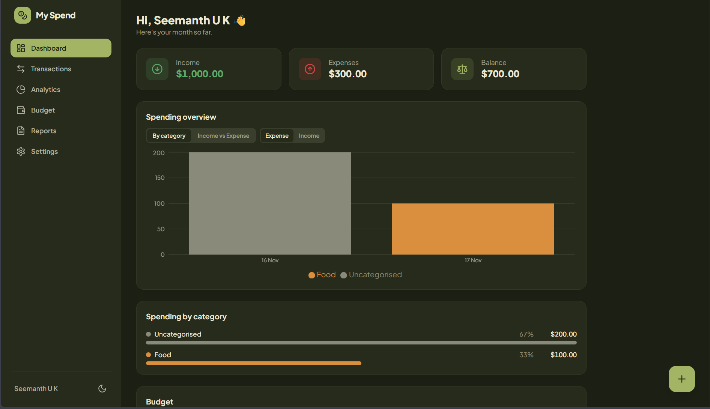
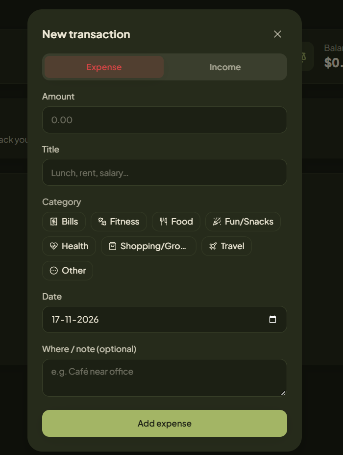
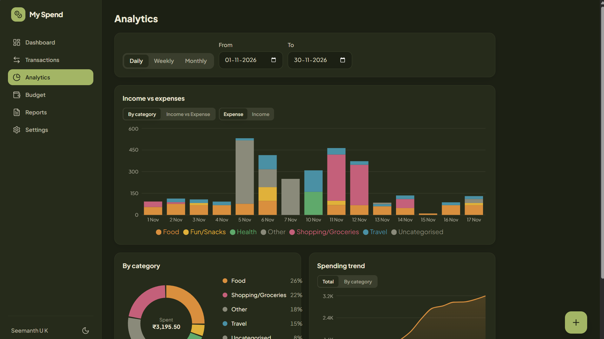

# MySpend

A personal expense tracking application designed to help users manage
their finances, track spending, and understand their financial habits.

## Overview

MySpend provides a centralized platform for recording and monitoring
expenses. It aims to make expense management simple, organized, and
accessible through an intuitive interface.

## Features

-   Expense tracking and management
-   Organized financial records
-   Spending overview and insights
-   User-friendly interface

## Tech Stack

  Layer      Technologies
  ---------- -------------------------------
  Frontend   \[Add frontend technologies\]
  Backend    \[Add backend technologies\]
  Database   \[Add database technologies\]
  Tools      Git, GitHub

## Application Preview

### Login


### Dashboard



### Transactions



### Analytics




> Make sure the images are saved in the `screenshots` folder using the
> filenames shown above. GitHub will display them when the paths match.

## Project Structure

``` text
MySpend/
├── client/                 # Frontend application
├── server/                 # Backend application
├── supabase/               # Supabase configuration
├── screenshots/
│   ├── dashboard.png
│   ├── transactions.png
│   ├── analytics.png
│   └── login.png
├── .github/                # GitHub workflows
├── LICENSE
└── README.md
```

## Getting Started

### Prerequisites

-   Node.js
-   npm
-   Git

### Installation

**1. Clone the repository**

``` bash
git clone https://github.com/uk-seemanth/MySpend.git
cd MySpend
```

**2. Install dependencies**

Install the dependencies for the client:

``` bash
cd client
npm install
```

If the server has its own `package.json`, install its dependencies
separately:

``` bash
cd ../server
npm install
```

**3. Configure environment variables**

Create the required `.env` files using the environment variables
expected by the project.

Do not commit API keys, passwords, or other secrets.

**4. Run the application**

Start the client and server using the development scripts defined in
their respective `package.json` files.

## Author

**Seemanth U.K.**

-   GitHub: [@uk-seemanth](https://github.com/uk-seemanth)
-   LinkedIn: [Seemanth U.K.](https://www.linkedin.com/in/uk-seemanth)

## License

This project is licensed under the MIT License. You are free to use,
copy, modify, distribute, and include this project in your own projects,
provided that the original copyright and license notices are retained
and proper credit is given to the original author.

See the [LICENSE](LICENSE) file for the full license terms.
